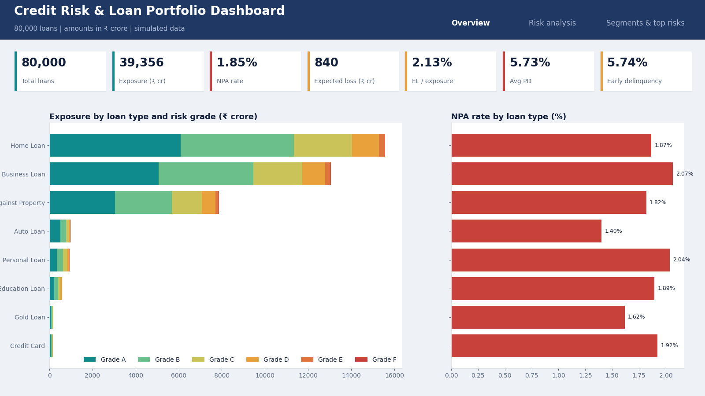
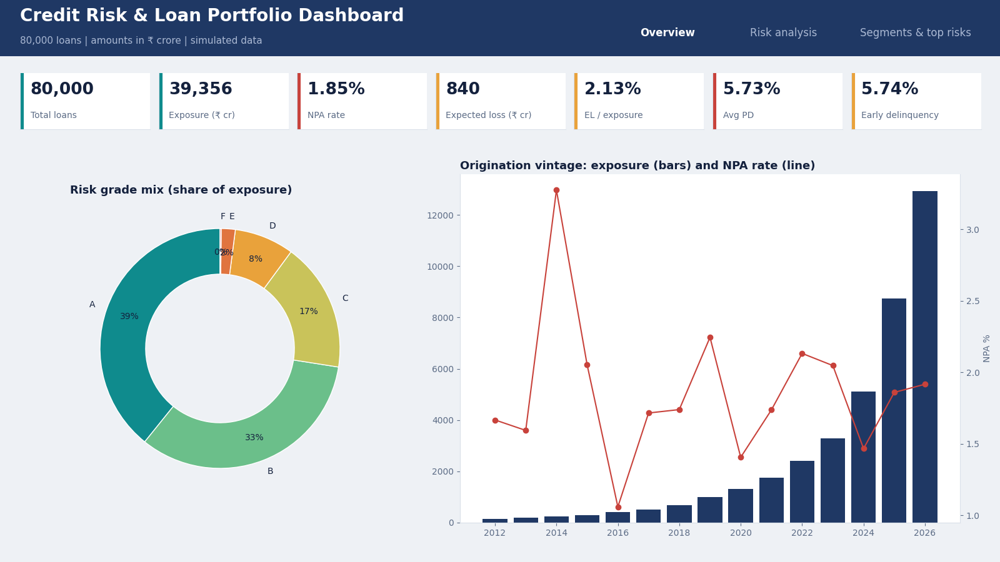
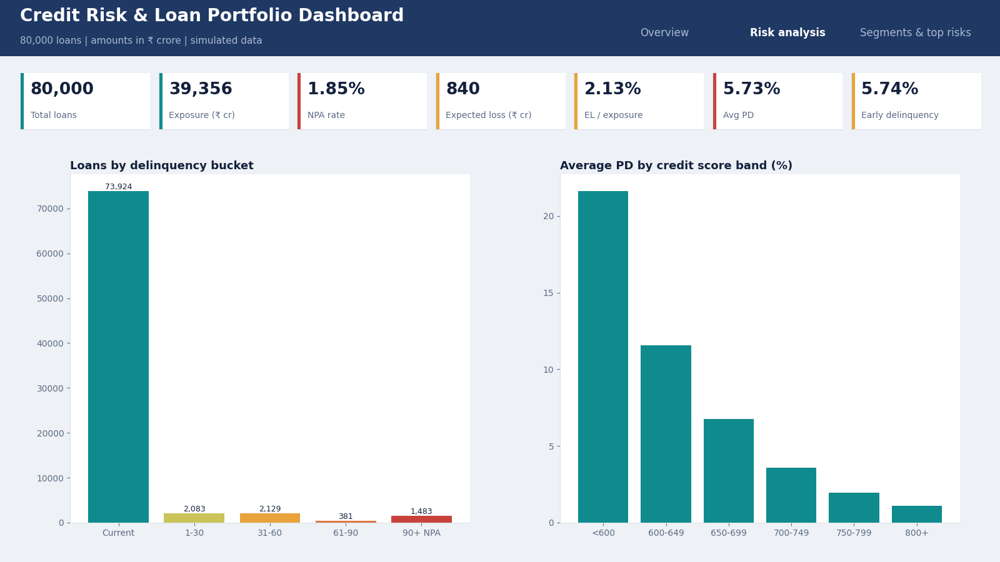
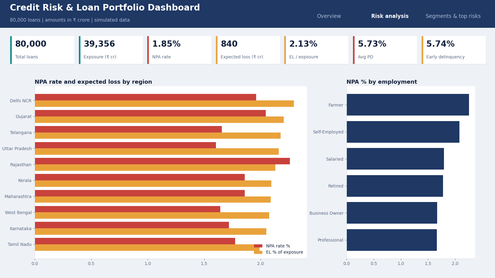
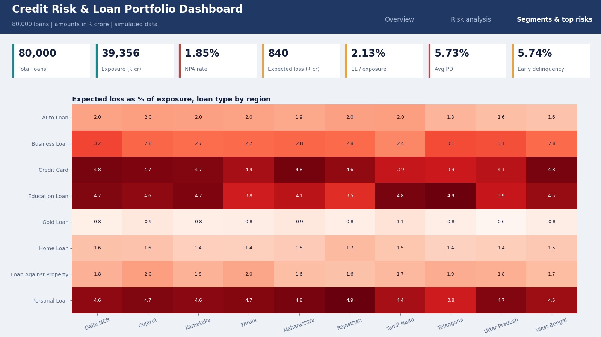
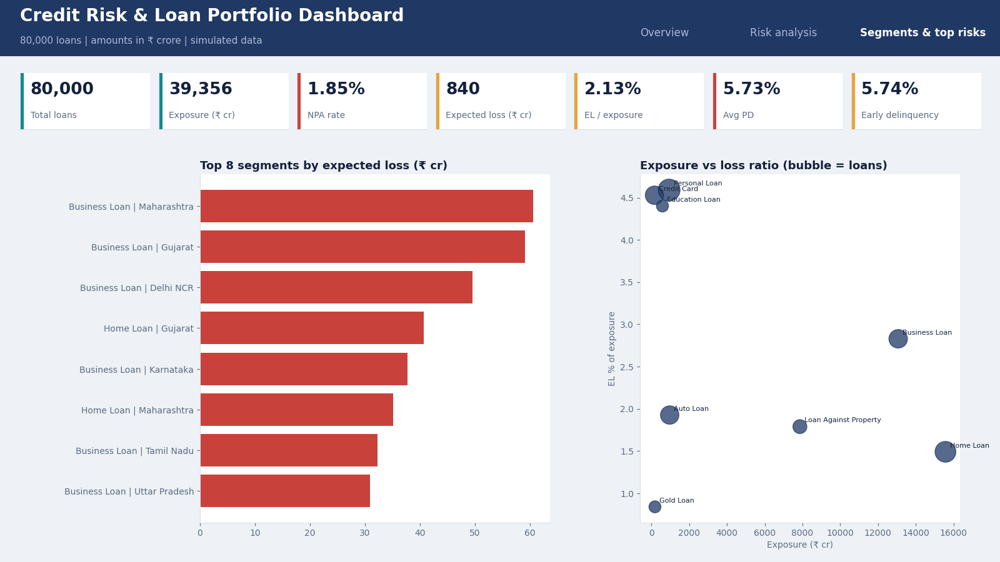

# Banking Credit Risk & Loan Portfolio Analytics

Interactive credit-risk dashboard for an 80,000-loan portfolio (simulated data, amounts in INR crore).

**Live demo:** https://banking-credit-risk-dashboard.vercel.app/

## Features
- 7 KPIs: loans, exposure, NPA rate, expected loss, EL %, average PD, early delinquency
- Filters for loan type, region, origination year and risk grade (options update to valid combinations)
- Click a chart bar or slice to filter the whole page
- 3 tabs: Overview, Risk analysis, Segments & top risks
- Export the current view as CSV

## Screenshots

### 1. Overview — KPIs and Exposure

### 2. Overview — Grade and Vintage

### 3. Risk — Delinquency and Score

### 4. Risk — Regional Analysis

### 5. Segments — Heatmap

### 6. Segments — Top Risks

## Files
- `index.html` the dashboard (single file, Chart.js from CDN)
- `Credit_Risk_Analysis.sql` schema and 8 analysis queries
- `PowerBI_Build_Kit.md` DAX measures, layout and theme for the Power BI version

## Tech
Power BI, Excel, SQL, Python (data generation), HTML + Chart.js.
NPA = more than 90 days past due. Expected loss = PD x LGD x outstanding balance.
